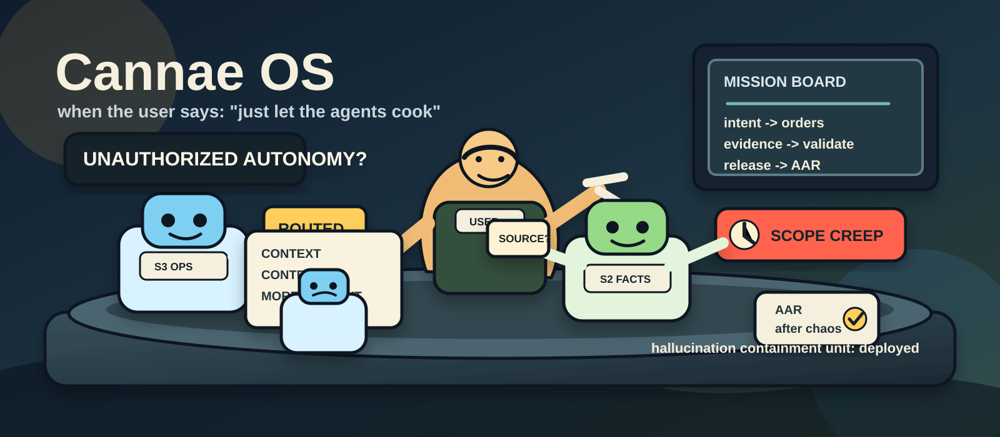
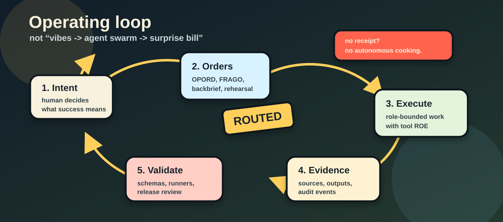
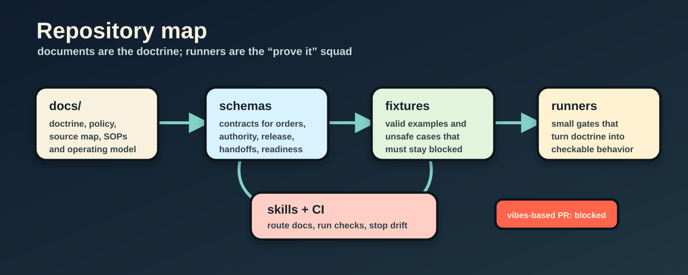
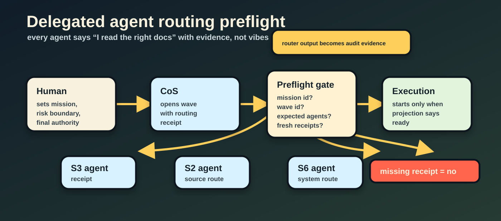
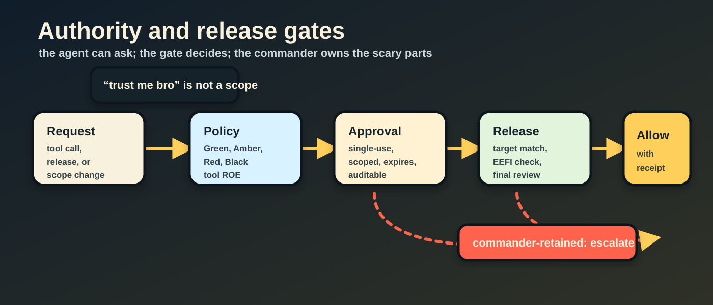
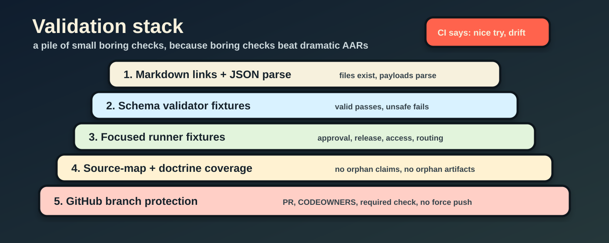

# Cannae OS

[](LICENSE-APACHE)
[](LICENSE-MIT)
[](#current-maturity)
[](#quick-start)

<p align="center">
  
</p>

Military-inspired command, control, and validation doctrine for operating LLM agents.

Cannae OS is a documentation-first framework for using LLMs and multi-agent systems with clearer intent, bounded authority, auditable handoffs, source discipline, and executable validation gates. It translates useful military operating patterns into AI work: commander's intent, OPORDs, FRAGOs, staff roles, CCIR, backbriefs, rehearsals, readiness checks, release review, and after-action learning.

The project is not a military operations manual. It is an operating model for complex knowledge work with AI agents.

## Origin

Autonomous AI work and AI transformation are becoming urgent topics. As more teams ask LLMs to perform work with less direct supervision, the central problem becomes harder: how do we preserve context, suppress hallucination, prevent authority drift, and still let AI execute useful work?

This project started from a conversation with a friend in the military. While discussing that problem, he said: "Isn't that exactly the military?"

That landed immediately.

Military organizations bring many different people into one system where intent can move from the highest decision-maker down to actual execution without being casually distorted. Along the way, subordinate units adapt the plan to their scale, function, and operating conditions, then issue more specific orders downward.

That is possible because military systems are built around explicit authority, bounded autonomy, role classification, reporting lines, standard documents, rehearsals, backbriefs, and after-action correction. The system is designed to conserve resources and win under uncertainty.

Cannae OS began from a simple question: is this the missing operating system for human-led AI teams?

## Why This Exists

Most LLM workflows fail in predictable ways:

- the user's intent gets diluted as work is delegated;
- agents read too much context, too little context, or the wrong context;
- authority boundaries are implicit;
- high-risk actions are approved too broadly;
- generated work is not tied to evidence;
- handoffs depend on chat memory instead of durable state;
- teams add more agents without clear roles, readiness, or sunset rules.

Cannae OS treats LLM work as a command-and-control problem:

```text
intent -> orders -> role-bounded execution -> evidence -> validation -> release -> AAR
```

<p align="center">
  
</p>

The goal is not to make agents more autonomous by default. The goal is to make delegated autonomy explicit, narrow, inspectable, and reversible where possible.

## Project Direction

The active product is a **document-driven skill/plugin for existing AI clients**:

1. Write and revise orders, SOPs, reports and handoffs without losing intent.
2. Route the minimum relevant documents by task, role, department and authority.
3. Preserve human final decisions and bounded single-agent or multi-agent work.
4. Maintain canonical documents, sources, indexes and repository-specific outputs.
5. Improve prompts and procedures from observed failures and AARs, with focused checks.
6. Distribute equivalent operating rules through Codex and Claude skills.

As decided on 2026-11-10, dashboards, approval applications, separate execution
services and production infrastructure are **deferred**. Existing code and proof
remain available, but they are not prerequisites for ordinary document work.
Existing guarded operations still retain their controls and unresolved holds.
See [Skill-First Product Scope](docs/skill-first-product-scope.md) for the active
acceptance criteria. A separate plugin package is not yet claimed implemented.

The [five baseline objectives](docs/skill-first-product-scope.md#completed-baseline-objectives)
cover authoring quality, role-bounded routing/delegation, a complete working flow,
bounded improvement/corpus maintenance, and client distribution. Preparatory
cleanup is recorded separately; none is declared complete from a routing pass.
The [2026-11-15 acceptance audit](docs/completion-backlog.md#five-goal-acceptance)
now records bounded completion of all five through source-appraised actual use
and local checks. This is not a guarantee of hallucination-free work or production
security; the limitations and deferred scope remain.

The next USER-requested cycle is [Skill Reliability And Efficiency](docs/skill-first-product-scope.md#active-objectives):
robust intake, smaller useful context, withheld-case quality, terminology/change
impact, repeatable cross-client workflows and reproducible maintenance. Its
[eighteen new criteria](docs/completion-backlog.md#skill-reliability-acceptance)
started planned; prior acceptance does not count as their completion. The
[frozen evaluation checkpoint](docs/completion-backlog.md#evaluation-freeze-checkpoint-2026-11-15)
closes SR01 only and retains ten failing development observations. Dashboards,
servers and optional plugin packaging remain deferred.
The [first English intake improvement](docs/completion-backlog.md#english-intake-development-2026-11-15)
resolves eight of those paired routing failures; Korean intake and reserved
evaluation remain open. This is local routing evidence, not native model quality.
The [bounded Korean intake follow-up](docs/completion-backlog.md#korean-intake-development-2026-11-15)
resolves the remaining development request in both providers while preserving
original wording and explicit limits. Reserved and native evaluation remain open.

The initial [conditional instruction split](docs/completion-backlog.md#conditional-instruction-delivery-2026-11-15)
reduced both entrypoints by 23.4% while retaining linked content/reporting, client,
terminology and delegated-wave procedures. Protected contexts bind all moved
guides. Local emission is not native reading or measured end-to-end context savings.
The [native authoring baseline](docs/completion-backlog.md#native-authoring-baseline-and-repair-2026-11-16)
now contains eight actual responses and source-appraised defects in derived units,
detached receiving context and unresolved source identity/history. Both skills
contain candidate repairs; their current entry reduction remains 21.2%. Candidate quality,
reserved evaluation and complete cross-client recovery chains remain unverified.

The [version-bound reference reader](docs/evaluation-metrics.md#version-bound-reference-measurement)
adds navigation and exact source-bound ranges through both skills. It preserves
full assigned inputs and separates emitted bytes from observed client delivery;
actual six-task context savings remain unverified.
The [paired context preparation](docs/evaluation-metrics.md#paired-context-inputs)
binds identical synthetic task sources to both exact revisions and providers.
Its snapshots and initial prompts are not native delivery or completed-work savings.
The [maintenance intake correction](docs/completion-backlog.md#own-skill-maintenance-intake-2026-11-16)
recognizes own-skill upkeep and bounded context evaluation while preserving
uncovered domain objectives, full prohibitions and guarded-input rejection.

<p align="center">
  
</p>

## What Is In This Repository

### Doctrine And Operating Model

- [Skill-First Product Scope](docs/skill-first-product-scope.md): active core, deferred platform work and honest completion criteria.
- [Document Authoring Workflow](docs/document-authoring-workflow.md): choose a format, preserve evidence and intent, revise the canonical document and hand off unresolved work without a dashboard.
- [Project Terminology Workflow](docs/project-terminology-workflow.md): [prepare source-bound proposals](docs/project-terminology-workflow.md#source-bound-change-proposals), [append reviewed changes with one writer](docs/project-terminology-workflow.md#reviewed-canonical-append), and bind current excerpts and required meanings. A [native compound-intake case](docs/project-terminology-workflow.md#native-compound-intake) preserves dependent holds without stopping unrelated drafting.
- [Registered Dependency Impact](docs/project-terminology-workflow.md#registered-dependency-impact): track declared source/term/upstream versions for documents and tasks, preserve independent work and prepare an explicitly reviewed refresh. Current inputs are not work correctness, automatic discovery or transfer authority.
- [Source-Grounded Authoring Case](docs/document-authoring-case-study.md): support SOP revisions, native collaboration, agent-invoked routing, [implicit Codex selection](docs/document-authoring-case-study.md#native-implicit-codex-selection) and [Claude receiving](docs/document-authoring-case-study.md#native-implicit-claude-receiving), with retained failures and bounded acceptance claims.
- [Readiness And Authority Intersection](docs/readiness-authority-intersection.md): reference policy consumers preserve minimum readiness, prohibitions, exact scope, overlapping restrictions and expiry through approval/release composition. Declared ratings are not authenticated qualification or actual tool authority.
- [Codex Default Model Binding](docs/codex-default-model-binding.md): bounded metadata-only host preparation freezes a concrete CLI model before exact owner transfer review. Selection is not account-access proof, inference consent or an automatic default upgrade.
- [Native Request Analysis](docs/native-order-analysis.md): purpose-bound existing-Codex proposals consumed by the actual OPORD compiler, with separate owner transfer review and [failed-analysis/publication acknowledgment](docs/order-analysis-reconciliation.md). Proposed drafts remain uncalibrated and require human coverage/adoption; no self-granted task authority.
- [Subject-Bound Workload Controls](docs/subject-bound-workload-controls.md): actual report admission scans exact report and work-evidence bytes in a bounded local worker, with a separate digest-only receipt. Framework fixture passes do not establish workload inspection; this core-pattern check is not release clearance or complete policy coverage.
- [Force Registry Enrollment](docs/force-registry-enrollment.md): stable, versioned organization/capability/performer definitions with separate authenticated owner review and immutable history. Enrollment is unassessed, not qualification, standing activation or an operational grant.
- [Readiness Drop Reconciliation](docs/readiness-drop-reconciliation.md): retained exact role/task drops fence real dispatch/gateway calls and narrow old leases without blocking admitted-result settlement. This is not a complete capability registry, positive qualification or automatic restoration.
- [Semantic Omission Evaluation](docs/semantic-omission-evaluation.md): source-bound existing-Codex collection with [exact authenticated owner transfer review](docs/model-transfer-consent.md), one-use session-bound consent, signed original-journal binding and [verified failed-transfer acknowledgment](docs/model-transfer-reconciliation.md). Verdicts remain advisory; calibrated model admission, unknown-result recovery and automatic replanning remain open.
- [Bounded Structural Plan Synthesis](docs/bounded-plan-synthesis.md): construct complete plans and policies from actual OPORD tasks and finite roster/policy/estimate bounds; preserve parent controls, remaining admission budgets and real revision/supersession gates. This zero-model structural generator is not calibrated semantic or strategic planning.
- [Requirement Inventory And Human Coverage Admission](docs/requirement-inventory-admission.md): source-accounted human review bound to the whole plan and actual adoption/context/next-call consumers. The owner preview compares source, requirements and real receivers without changing the exact approval subject through display filters. This separate review class is not calibrated model admission or proof of semantic completeness; legacy records remain readable without renewed execution permission.

- [Operational COP](docs/operational-cop.md): authenticated, read-only Operations views replay actual wave/control history with freshness, exact evidence links and mission-bounded accounts. Display filters cannot hide authorized critical alerts. This is not worker liveness, tool authority or the complete reporting/CoS workflow.
- [Completion Backlog](docs/completion-backlog.md): the remaining program scope, dependencies, and evidence required for closure.
- [Implementation Candidate Registry](docs/implementation-candidate-registry.md): source-bound requirements, actual implementation mappings, and executable completion checks.
- [Request Intake And Order Drafts](docs/request-order-intake.md): retain exact requests, separate quotes from assumptions and proposals, and compile non-executable OPORD/task drafts with inherited constraints.
  Complete serialized drafts must fit the unchanged 8 MiB reader limit; excessive
  reference expansion is rejected before publication, never silently truncated.
- [Exact Order Adoption And Plan Binding](docs/order-adoption-and-plan-binding.md): bind the complete plan, each agent's backbrief and rehearsal to one finite USER scope decision; recheck it at lifecycle and dispatch admission without granting release or bypassing other gates.
- [Order Revision And Supersession](docs/order-revision-and-supersession.md): review a full changed plan against its exact predecessor, prepare successor contexts, settle old execution and supersede before new tool authority.
- [Mandatory Intent Continuity](docs/intent-continuity-runtime.md): bind every new context to the plan's complete task commitments and USER-rooted delegation chain; deny missing tasks, widened child authority and legacy-context tool reuse while preserving admitted-result settlement.
- [Local Operator Console](docs/local-operator-console.md) (deferred development): retained loopback login, mission-bounded evidence, [exact order decisions and outcome replay](docs/operator-consent-and-adoption.md), plus [fresh authenticated terminal reconciliation](docs/operator-terminal-reconciliation.md). Confirm worker exit, retain exact cancellation/acknowledgment evidence and preserve original failures/expiry. [Session browser checks](operator-console-fixtures/session-browser-check.js) reject delayed owner data after viewer login and inverted selections without bypassing auth limits. Broader tool approvals, operational COP and production protection remain open; adoption or reconciliation is not execution authority.

- [Military LLM Framework](docs/military-llm-framework-v0.1.md): the core command, authority, reporting, and AAR model.
- [Military Operating System](docs/military-operating-system.md): the layered operating system view of doctrine, SOP, intent, planning, orders, risk, liaison, assessment, and learning.
- [Agent Roles and Authority](docs/agent-roles-and-authority.md): role responsibilities, approval scope, reporting scope, autonomous action, and post-action controls.
- [Commander Handbook](docs/commander-handbook.md): how a human final decision-maker should issue intent, approve work, and manage risk.
- [Functional Domains](docs/functional-domains.md): mapping military functional domains to AI work functions.
- [Mission Command Runtime Policy](docs/mission-command-runtime-policy.md): a machine-checkable commander's intent that survives delegation across agent echelons.
- [Disciplined Initiative Rules](docs/disciplined-initiative-rules.md): bounded initiative, drift classes, and mandatory stop or escalation behavior.
- [Chief of Staff Agent](docs/chief-of-staff-agent.md): staff integration, battle-rhythm ownership, and the authorities a CoS agent never owns.
- [Common Operational Picture State](docs/common-operational-picture-state.md): an event-derived mission projection with staleness and need-to-know rules.
- [Reporting Threshold Policy](docs/reporting-threshold-policy.md): exception-first must-report, may-stay-silent, and must-not-report rules.

### Orders, Handoffs, And Execution Control

- [Prompt Templates](docs/prompt-templates.md): OPORD, WARNO, FRAGO, SITREP, and AAR prompt structures.
- [Orders Production Pipeline](docs/orders-production-pipeline.md): request -> mission analysis -> OPORD -> task order -> backbrief -> rehearsal -> execution -> AAR.
- [Backbrief and Rehearsal SOP](docs/backbrief-and-rehearsal-sop.md): confirmation steps that reduce instruction distortion before execution.
- [OPORD Annex Model](docs/opord-annex-model.md): separation between command intent and specialist annexes.
- [Personnel Continuity Model](docs/personnel-continuity-model.md): succession, rotation, degraded mode, handoff, and vital records.
- [Dry-Run Approval UI](docs/dry-run-approval-ui.md): commander dispositions and evidence requirements after rehearsal or dry run.
- [Handoff Packet Template](docs/handoff-packet-template.md): mandatory transfer fields, triggers, and acceptance checks for continuity.

### Multi-Agent Organization

- [LLM Agent Org Chart](docs/llm-agent-org-chart.md): command relationships, staff functions, RACI, and reporting lines.
- [Agent Battle Rhythm](docs/agent-battle-rhythm.md): recurring status, decision, approval, and synchronization cadence.
- [Interdepartment Collaboration Policy](docs/interdepartment-collaboration-policy.md): supported/supporting relationships, liaison, handoff, and conflict routing.
- [B2C2WG Operating Model](docs/b2c2wg-operating-model.md): boards, bureaus, centers, cells, and working groups for multi-agent work.
- [AI Special Operations TF](docs/ai-special-operations-tf.md): high-risk or high-uncertainty task force activation with independent review, enablers, and abort criteria.
- [Force Structure Change Policy](docs/force-structure-change-policy.md): when to create, expand, reduce, merge, deactivate, or disband roles, units, and task forces.
- [Model Force Assignment Policy](docs/model-force-assignment-policy.md): mission-based allocation of deterministic, line, specialist, command, SOF, assurance, and reserve model capacity.
- [Model Force v0.2 Operations](docs/model-force-v0.2-operations.md): registry-to-compiler-to-routing-preflight procedure for dispatching heterogeneous agent forces.
- [Bounded Self-Improvement Operations](docs/bounded-self-improvement-operations.md): evidence-driven improvement of active work and control-plane candidates with finite budgets, rollback, escalation, and human release authority.
- [Guarded Supervisor Publication](docs/bounded-self-improvement-operations.md#281-guarded-supervisor-publication): fresh admission at challenge/order storage, exact reuse, and partial-issuance recovery.
- [Explicit Campaign Stop](docs/bounded-self-improvement-operations.md#210-explicit-user-stop-intake): exact USER stop intake, immutable mission fencing, admitted-result retention, and explicit settlement/restart limits.
- [Campaign Terminal Reconciliation](docs/campaign-terminal-reconciliation.md): historical wave/dispatch/settlement replay and a current non-authorizing terminal inventory.
- [Exact Campaign Successor Admission](docs/campaign-successor-admission.md): full candidate proposals, fresh exact USER consent, held partial publication, immutable admissions and later-stop enforcement. Normal supervisor and dispatch gates still apply.
- [Liaison Agent Model](docs/liaison-agent-model.md): bounded representation across external tools, teams, and agent frameworks.
- [Partner Command Relationship](docs/partner-command-relationship.md): explicit external request, coordination, and authority relationships.

### Authority, Risk, Release, And Security

- [Disciplined Method Runtime](docs/method-deviation-runtime.md): reviewed exact-input alternatives, before/after SITREPs, canonical event order, actual drift fences/revocation and guarded completion/report consumers. Whole control-record copies are not task outputs. Novel methods, recovery and universal rollout remain open.
- [Local Method Control Channel](docs/method-control-channel.md): reviewed method/channel policies, dormant stdio startup, exact initial and continuation enrollment, shared root budgets/deadline and three bounded agent metadata tools. Lost responses hold work; local enrollment is not native startup attestation or production isolation.
- [Dispatch Issuance Recovery](docs/dispatch-issuance-recovery.md): freeze a new lease before supersession, finish only missing publications, and cancel unused issuance without restoring old authority. Pending issuance stays visible through task, report and terminal gates; legacy leases are result-only.
- [Tool Use ROE](docs/tool-use-roe.md): Green, Amber, Red, and Black tool-use boundaries.
- [Approval Scope Policy](docs/approval-scope-policy.md): single-use approvals, expiry, rollback, evidence, renewal, revocation, and delegation.
- [Risk Acceptance Authority](docs/risk-acceptance-authority.md): residual risk acceptance and commander-retained authority.
- [Context Releasability Policy](docs/context-releasability-policy.md): role-based context release and final-output controls.
- [Exact GitHub Release Authorization](docs/github-release-authorization.md): one short-lived USER grant bound to the exact repository, tag, commit, main CI, notes, latest non-genesis monitor artifact, and verified receipt.
- [GitHub Release Immutability](docs/github-release-immutability.md): separately authorized repository policy activation and prospective immutable-state enforcement for future releases.
- [GitHub Release Integrity Monitoring](docs/github-release-integrity-monitoring.md): continuous policy-drift and GitHub-signed release-attestation verification without mutation or release authority.
- [Independent GitHub Release Verification](docs/github-release-independent-verification.md): pinned TUF-chain replay, exact historical producer compatibility, and bounded brace/IPv6-zone dependency regressions without rewriting evidence or hiding unresolved advisories.
- [GitHub Release Trust Checkpoint Continuity](docs/github-release-trust-checkpoint-continuity.md): monotonic prior-state comparison, stable run/attempt artifact lineage, rerun-fork rejection, and fail-closed rollback/equivocation detection.
- [OPSEC Classification Model](docs/opsec-classification-model.md): EEFI, classification, releasability, and sensitive-output handling.
- [Role Document Access Policy](docs/role-document-access-policy.md): validated, profile-bounded reading lists with distinct raw/summary/reference modes. Blocked projections expose no allowed rows; metadata is not actual access authorization.
- [Sensitive Output Filter](docs/sensitive-output-filter.md): digest-only detection, redaction, blocking, and escalation at output and tool boundaries.
- [Interop Release Packet](docs/interop-release-packet.md): the only approved boundary-crossing package for partner-facing information.

### Training, Readiness, And Sustainment

- [Training Progression Model](docs/training-progression-model.md): crawl-walk-run progression and evidence-based promotion per METL task.
- [Readiness-to-Authority Policy](docs/readiness-to-authority-policy.md): readiness ceilings that never create approval, risk, or release authority.
- [Sustainment Agent SOP](docs/sustainment-agent-sop.md): resource watches, endurance drills, and tool-outage response for the S4 agent.
- [Resource Priority Policy](docs/resource-priority-policy.md): priority of support, preemption, starvation prevention, and FRAGO-controlled changes.

### Research And Source Discipline

- [Source Map](docs/source-map.md): traceability between military doctrine sources and local framework artifacts.
- [Research Compendium](docs/research-compendium.md): research notes, interpretations, and open research gaps.
- [Source Reliability Rubric](docs/source-reliability-rubric.md): source quality, interpretation risk, and evidence handling.
- [Multinational Doctrine Consistency Review](docs/multinational-doctrine-consistency-review.md): checks against US-only assumptions and terminology drift.
- [Korean Military Sources](docs/korean-military-sources.md) and [Korean Org Culture](docs/korean-org-culture.md): localization notes and cultural adaptation.

### Runtime Contracts And Prototypes

- [Schema Files](schema-files/README.md): JSON Schema contracts for missions, orders, authority, approvals, risk, release, readiness, handoffs, routing receipts, and more.
- [Sample Payloads](sample-payloads/README.md): valid and invalid payloads for validator fixtures.
- [Validator CLI Prototype](validator-cli-prototype/README.md): local schema and semantic validation using the repository's pinned dependencies.
- [Policy Engine Prototype](policy-engine-prototype/README.md): local policy decisions for tool requests.
- [Reference Architecture](docs/reference-architecture.md): orchestrator, policy engine, tool gateway, evidence store, event log, and dashboard architecture.
- [Runtime Automation Roadmap](docs/runtime-automation-roadmap.md): path from manual doctrine docs to a tool-gated runtime.
- [Skill Operational Mission Lifecycle](docs/skill-operational-mission-lifecycle.md): mandatory routing, control receipts, report/AAR handling, evidence-preserving termination, publication-time campaign checks, and retained unknown-effect holds. Terminal reconciliation and exact successor admission are separate operations; unsupported gateway containment remains open.
- [Tool Effect Review](docs/tool-effect-review.md): binds an unknown invocation, declared effect scope, observations, verification plan, and receipt into a non-authorizing packet. Evidence consistency is not USER consent or settled effects.
- [Gateway Effect Review](docs/gateway-effect-review.md): classifies exact retained gateway history, preserves missing-input orphans, and binds admission/effect/containment/coordination inspection scope. It neither clears a hold nor grants execution authority.
- [Gateway Effect Settlement](docs/gateway-effect-settlement.md): reconciles an exact orphan admission or signed-containment OCI reference outcome using execution-bound quorum and fresh USER judgement. Preserves original failure, consumes proof inputs once across settlement families, and requires separate post-settlement revocation. Other containment adapters and managed coordination remain open.
- [Tool Effect Settlement](docs/tool-effect-settlement.md): resolves one unknown hook outcome from an exact USER scope decision and execution-bound verifier quorum. A separate failed-agent marker survives legacy status and resume lineages; post-settlement revocation does not permit success reporting or resume. Gateway cleanup and full campaign restart remain separate.
- [Enforced Dispatch And Resumable Execution](docs/enforced-dispatch-and-resume.md): per-agent session leases, fail-closed tool admission, checkpoints, interruption, revocation, and explicit resume.
- [Protected Tool Gateway Contract](docs/protected-tool-gateway-contract.md): identity-bound, idempotent transactions with gateway-owned admissions, exact commit correlation, and retained obligations that block hook/lease completion bypasses. Unknown gateway effect settlement remains open.
- [Gateway Identity Admission](docs/gateway-identity-admission.md): TLS 1.3 mTLS, SPIFFE X.509, signed one-use challenge, exporter-bound principal evidence, and replay-safe authenticated-reference admission.
- [Protected Process Execution](docs/protected-process-execution.md): policy-pinned executable/argv, signed pre-execution envelope, signed post-execution observation, exact gateway appraisal, and no-rerun recovery.
- [Exact GitHub Release Authorization](docs/github-release-authorization.md): terminal authorization and publication verification without widening any lower execution contract.
- [GitHub Release Immutability](docs/github-release-immutability.md): exact USER-authorized repository policy activation and future release immutability gate.
- [GitHub Release Integrity Monitoring](docs/github-release-integrity-monitoring.md): tracked activation baseline, full/release-event observations, retained attestation evidence, and fail-closed scheduled monitoring.
- [Independent GitHub Release Verification](docs/github-release-independent-verification.md): complete GitHub TUF evidence, offline root replay, pinned bundle verification, and CLI-to-signed-statement cross-checks.
- [GitHub Release Trust Checkpoint Continuity](docs/github-release-trust-checkpoint-continuity.md): USER genesis, monotonic TUF state, bounded artifact retention, publisher v0.5, and monitor v0.3.
- [Verifier Execution Integrity](docs/verifier-execution-integrity.md): exact code, runtime, repository state, and execution-evidence assurance.
- [GitHub Actions Native Verifier Adapter](docs/github-actions-native-verifier-adapter.md): manifest-pinned GitHub OIDC/JWKS appraisal for hosted reusable workflows.
- [GitLab CI Native Verifier Adapter](docs/gitlab-ci-native-verifier-adapter.md): manifest-pinned GitLab.com OIDC/JWKS appraisal for protected same-project pipelines.
- [Verifier Pre-Dispatch Challenge](docs/verifier-pre-dispatch-challenge.md): supervisor-issued nonce, liveness, deadline, and replay-resistant admission.
- [Verifier Independence Assurance](docs/verifier-independence-assurance.md): provider, operator, control-plane, tenant, runner, infrastructure, region, and zone correlation.
- [Transparency Operations](docs/transparency-operations.md): checkpoint consistency, witnesses, monitors, TUF root rotation, incidents, revocation, and continuous admission.
- [Model Force v0.2 Fixtures](model-force-v0.2-fixtures/README.md): integrated registry, compilation, routing receipt, dispatch, and telemetry examples.

### Agent Skills

- [Controls Doctrine Operator Skill](codex-skills/controls-doctrine-operator/SKILL.md): Codex skill for routing this corpus by task, role, department, authority, and validation surface.
- [Claude Code Controls Doctrine Operator Skill](.claude/skills/controls-doctrine-operator/SKILL.md): equivalent Claude Code project skill.
- [AI CLI Skill Installer](install-ai-cli-skills.sh): installs the Codex and Claude Code skill entries.
- [Installed Skill Inspector](skill-installation-inspector.js): compare an explicit installed directory with the trusted checkout's current bundle and default corpus binding, without executing installed code or changing settings. A match is not native discovery or work acceptance.
- [Authoring Evaluation Preparation](skill-authoring-evaluation.js): prepare exact full-body baseline writing inputs with byte-range accounting and separate evaluator references. No model dispatch, implicit-discovery claim, withheld execution or quality acceptance follows from preparation; see [Evaluation Metrics](docs/evaluation-metrics.md) and its [prepared-input protocol](docs/evaluation-metrics.md#explicitly-prepared-authoring-inputs).

## Core Concepts

### Human Final Decision Authority

When a human user invokes the framework directly, the human remains the final decision-maker. The AI can brief, recommend, draft, validate, and warn. It should not restrict the user's view of the repository just because an AI role would have limited access.

### Delegated AI Operator

When an AI is acting as a role, department, staff section, or task force, it must operate within a declared boundary:

- role;
- department;
- authority scope;
- task;
- release target;
- risk level;
- need-to-know.

Delegated AI work should be routed through the Controls Doctrine Operator skill before execution.

<p align="center">
  
</p>

### Routing Receipts

The repository includes a routing receipt contract and preflight gate. A delegated wave should not start only because an agent says it routed its documents. It should produce a machine-checkable receipt.

Example:

```bash
node codex-skills/controls-doctrine-operator/scripts/route_controls_docs.js \
  --receipt \
  --scope=agent \
  --mission=MIS-example \
  --wave=W2 \
  --agent=plans-agent \
  --actor=ai \
  --role=S3 \
  --department=operations \
  --authority=scoped-execution \
  --capability-query="Define and validate the target mission capability" \
  -- "plans-agent W2 execution planning" .
```

The producer validates receipts before printing or persisting them. Invalid
role/authority/objective declarations or unavailable validation fail without
emitting receipt JSON or changing the artifact store. Receipt mode needs the
bound checkout's validator and lockfile dependencies; direct routing does not.
Successful emission is not preflight, source delivery or execution approval.
See [the producer correction](docs/document-authoring-case-study.md#receipt-producer-validation)
for the reproduced failure, denial checks and limits.

A [native source-failure handoff](docs/document-authoring-case-study.md#source-failure-and-changed-policy-handoff)
also exercises changed instructions across Codex and Claude. Required holds
survived, but generated activity summaries and source labels still needed human
appraisal. Passing tool traces are not proof that a handoff is semantically correct.
The [current-guidance follow-up](docs/document-authoring-case-study.md#current-guidance-handoff-repair-review)
shows both clients repairing those two errors, with a remaining locator caveat
recorded separately. Proposed document quality does not imply USER adoption.

Routing receipts distinguish document relevance from mission capability
coverage. If the mission objective has no specific corpus capability route,
the router returns `capability_routing.status: gap_detected`, assigns one
mission-scoped provisional capability cell, and opens a standing-department
candidate under the force-structure controls. The cell may analyze and draft
within the agent's existing authority; it cannot expand authority or activate
the standing department. Those decisions remain with the human USER through a
validated `ForceStructureChangeOrder`.

Preflight:

```bash
node agent-routing-preflight-runner.js agent-routing-preflight-fixtures/valid-wave-routing-bundle.json
```

Manual receipt commands remain useful for inspection and debugging. Delegated operational work should use the lifecycle controller so every expected receipt and context pack is generated and checked together:

```bash
node codex-skills/controls-doctrine-operator/scripts/operate_controls_mission.js \
  open sample-payloads/valid-mission-wave-plan.json \
  --repository . \
  --artifact-root .cannae/artifacts
```

The controller returns `context_dispatch_authorized: true` only after routing,
optional model assignment, bounded campaign, context digest, and repository
artifact checks pass. It still returns `tool_execution_authorized: false` and
`dispatch_authorized: false`: opening a wave creates context, not executable
authority. It never grants release authority. See
[Skill Operational Mission Lifecycle](docs/skill-operational-mission-lifecycle.md).

### Enforced Agent Dispatch

Mission `open` proves routing readiness; it does not authorize a tool call. Each
independently acting agent receives a separate deny-by-default policy and one
lease lineage bound to its repository, mission, wave, provider session, and last
checkpoint:

```text
USER plan authorizes exact policy-draft digest
             -> controller-compiled dispatch policy -> session lease
             -> PreToolUse admission -> tool -> PostToolUse checkpoint
```

Hash the policy draft before opening the wave, place that digest in the
`MissionWavePlan.dispatch_control.policy_authorizations` row for the exact
agent/provider/policy tuple, then open, compile, and issue:

```bash
node install-dispatch-hooks.js --provider all --repository . --dry-run

node codex-skills/controls-doctrine-operator/scripts/operate_dispatch_runtime.js \
  hash-input dispatch-tool-policy-draft.json --repository .

node codex-skills/controls-doctrine-operator/scripts/operate_controls_mission.js \
  open mission-wave-plan.json --repository . --artifact-root .cannae/artifacts

node codex-skills/controls-doctrine-operator/scripts/operate_dispatch_runtime.js \
  authorize-policy --repository . --artifact-root .cannae/artifacts \
  --policy dispatch-tool-policy-draft.json

node codex-skills/controls-doctrine-operator/scripts/operate_dispatch_runtime.js \
  issue --repository . --artifact-root .cannae/artifacts \
  --policy-id DTP-example --session provider-session-id \
  --provider-agent main
```

Unknown tools, replay, ambiguous rules, repository drift, expiry, and retained
actions deny by default. Complete the lease before reporting successful agent
work. `resume`, `clear`, and `fork` never restore authority from conversation
history; explicit checkpoint review and a lineage-continuation lease are
required. Project-local hooks cover supported local tool paths but are not a
non-bypassable security boundary. See
[Enforced Dispatch And Resumable Execution](docs/enforced-dispatch-and-resume.md).

### Protected Tool Transactions

Phase 17A adds a durable transaction around the Phase 16 dispatch admission.
Phase 17B1 adds a manifest-backed authenticated principal. Phase 17B2A adds
one policy-pinned ELF or Mach-O local process with signed before/after
evidence. Phase 17B2B adds a measured OCI/Linux reference provider. Phase
17B2C1 composes that provider with independently appraised production
admission:

```text
TLS 1.3 mTLS + exact SPIFFE identity + one-use signed challenge
-> exporter-bound signed principal evidence
-> authenticated principal + trusted gateway config
-> exact lease/policy/checkpoint/repository/input binding
-> received -> authorized -> executing
-> signed pre-create envelope
-> immutable image + exact target + measured Docker configuration
-> kernel probe for privilege + mounts + cgroup + network
-> signed host/runtime/image/key/MAC/filesystem/network appraisal quorum
-> computed failure-domain diversity + exact deployment agreement
-> live external linearizable coordination + storage fencing
-> verified container cleanup + signed observation
-> committed receipt | aborted cancellation | recovery-required block
```

`protected-tool-gateway.js` never stores raw tool input in its ordinary audit
contracts. One idempotency key and transaction ID bind one canonical request,
and `begin` returns the exact execution-event reference needed by `commit`. An
authorized request that never started can be cancelled with the same raw input;
a crash-retained allow admission is cancelled or its lease is blocked, and an
executing request with an unknown outcome blocks the lease instead of claiming
success. Protected process and OCI sandbox inputs contain only one policy
reference and rule ID. The gateway reloads every retained policy, envelope,
probe, observation, and result binding before issuing `ToolExecutionReceipt`
v0.4. Once an envelope exists, retry never executes the transaction again.

The OCI reference provider uses an immutable image with an exact probe
entrypoint and directly extracts and hashes `/cannae-probe` before execution.
It applies
digest-pinned seccomp, non-root UID/GID, all capabilities dropped,
`no_new_privs`, private namespaces, read-only root and repository mounts,
cgroup v2 limits, and measured external IP egress denial. A static probe directly measures
the corresponding `/proc`, mount, cgroup, address, route, and connection state.
Cleanup requires a successful all-states listing excluding the exact container;
a failed inspect or unavailable daemon is not evidence of absence. A containment
retry never reruns the target or converts `recovery_required` into success.
The v0.2 envelope also binds the observed daemon ID. Recovery retains a separate
signed, fresh containment observation after checking the original daemon and
CLI on both sides of cleanup. This is reference evidence, not independent host
attestation, gateway settlement, or managed coordination proof.

Phase 17B2B alone remains reference execution and keeps production execution
false. Phase 17B2C1 raises `production_execution_authorized` only for a
request v0.3 whose exact OCI policy is covered by a current USER policy, fresh
independently signed appraisals from at least two computed failure domains, a
separately signed admission, and a live external coordinator whose identity
matches the appraised deployment. Admission, begin, commit, and recovery all
recheck that boundary. Terminal receipt v0.5 records whether the deployment
remained verified; release authorization remains false.

This repository validates and composes those claims. It does not operate the
TPM/TEE, KMS/HSM, registry, hardened host, external coordinator, storage
fencing, or installation-level side-path controls that make them true. The
standalone gateway CLI therefore has no managed-production coordinator and
denies that path. See
[Protected Tool Gateway Contract](docs/protected-tool-gateway-contract.md) and
[Gateway Identity Admission](docs/gateway-identity-admission.md), then
[Protected Process Execution](docs/protected-process-execution.md) and
[OCI Linux Sandbox Provider](docs/oci-linux-sandbox-provider.md), followed by
[Production Sandbox Admission](docs/production-sandbox-admission.md).

### Heterogeneous Model Dispatch

Model selection is a separate control from agent routing and authority. Define an immutable registry snapshot and mission billet request, compile only eligible profiles, then bind current-wave receipts and billets through the integrated preflight:

```bash
node model-assignment-compiler.js \
  sample-payloads/valid-model-registry.json \
  sample-payloads/valid-model-assignment-request.json

node integrated-mission-preflight-runner.js \
  sample-payloads/valid-integrated-mission-preflight.json
```

Only a `ready` integrated projection emits dispatch rows. The model profile never inherits approval, risk acceptance, or release authority from its capability band.

### Repository-Isolated Artifacts

For multi-repository campaigns, durable AI outputs are stored under a stable repository identity instead of a shared flat output directory:

```text
.cannae/artifacts/repositories/<repository-key>/missions/<mission>/<wave>/<kind>/
```

Use `repository-artifact-store.js`, or pass `--write-artifact --repository <target>` to the model compiler and integrated preflight. Routing receipts use `--write-artifact --target-repository <target>`. See [Repository Artifact Isolation Policy](docs/repository-artifact-isolation-policy.md).

### Bounded Self-Improvement

Substantial AI missions can maintain a finite improvement campaign around work already in progress:

```text
campaign -> verifier workload proof -> runtime-policy admission -> finite cycle order -> candidate -> executed receipt/report -> execution evidence -> signed quorum -> decision -> next admission
```

`verification-runner.js` executes exact argument arrays without a shell and persists repository-state-bound receipts. A v0.3+ campaign additionally requires fresh Ed25519 DSSE receipt attestations from distinct trusted keys and policy-defined independence groups. For `skill` and `runtime_control` candidates, `comparative-evaluation-runner.js` executes one pre-persisted harness and one sealed evaluation set against isolated baseline and candidate worktrees, then applies campaign-owned absolute and non-regression thresholds. Schema v0.4 also requires `comparative-evaluation-attestation-runner.js` to bind a fresh multi-key, multi-group quorum to the exact persisted report, plan, evaluation set, baseline, candidate, evaluator invocation, campaign, and repository. Verifier keys can be purpose-limited, so receipt trust does not implicitly grant comparative-report signing authority. `autonomous-improvement-controller.js` reloads and recomputes the report and both quorums with the trust policy, accepted parent, and any consumed approval event before promotion.

Trust-policy v0.2 additionally requires a current manifest-backed `VerifierIdentityEvidence` for every verifier counted at dispatch; v0.3 can use native Sigstore bundles instead. `campaign-supervisor.js` independently verifies the selected workload adapter and emits `ready` only when authenticated verifier populations can form every purpose quorum.

Phase 12A trust-policy v0.4 also binds an exact `VerifierRuntimePolicy`. Every counted receipt or report attestation must cite fresh, manifest-backed `VerifierExecutionEvidence` dual-signed by a separate trusted builder and the registered verifier. It fixes the verifier code, immutable OCI image, dependency lockfile, harness, argv, tool allowlist, network and sandbox controls, provider claims, exact repository state and verification target. Phase 14 adds runtime-policy and execution-evidence v0.3 native adapters: GitHub-hosted reusable workflows and protected same-project GitLab.com pipelines can be admitted through strict manifest-pinned JWKS and OIDC signature/claim verification. Enterprise/self-managed providers, self-hosted runners, local hosts, and TEE appraisal remain future work. See [Verifier Execution Integrity](docs/verifier-execution-integrity.md), [GitHub Actions Native Verifier Adapter](docs/github-actions-native-verifier-adapter.md), and [GitLab CI Native Verifier Adapter](docs/gitlab-ci-native-verifier-adapter.md).

Phase 12B trust-policy v0.5 adds a supervisor-issued, single-use `VerifierChallengeSet` before every bounded dispatch. Each verifier must return fresh dual-signed workload identity evidence containing its exact nonce inside the deadline. Cycle-order v0.5 records exact challenge/response references and rejects missing, late, wrong-nonce, ambiguous, expired, replayed, or offline responders before quorum calculation. See [Verifier Pre-Dispatch Challenge](docs/verifier-pre-dispatch-challenge.md).

Phase 12C trust-policy v0.6 replaces declared independence labels with deterministic failure domains. Runtime-policy v0.2 records nine provider, operator, control-plane, account, project, runner, infrastructure, region, and zone identities; sharing any component correlates verifiers transitively. Execution-evidence v0.2 binds the observed identities under builder and verifier signatures, and receipt/report quorum uses computed `VID-*` domains. See [Verifier Independence Assurance](docs/verifier-independence-assurance.md).

Phase 13 trust-policy v0.7 requires a current append-only `TransparencyState` before dispatch. Signed log checkpoints must connect through RFC 6962 consistency proofs and satisfy separate witness and monitor operator quorums; TUF root changes require old/new thresholds, USER activation, and retained expiry boundaries; incidents and revocations remain immutable history. The supervisor reconstructs the full state sequence and reloads every embedded evidence object from the repository manifest. See [Transparency Operations](docs/transparency-operations.md).

Every decision and cycle order keeps `release_authorized: false`; trust-root changes, policy, authority, merge, push, and external release remain human decisions. See [Bounded Self-Improvement Operations](docs/bounded-self-improvement-operations.md).

Use `self-improvement-campaign-init.js` to bind conservative campaign defaults to a target Git repository before the first adaptive wave.

```bash
node campaign-supervisor.js \
  --repository ../target-repository \
  --campaign SIC-example \
  --artifact-root .cannae/artifacts \
  --write-artifact
```

Delegated agents may execute only a cycle order whose `status` is `ready`, `execution_authorized` is `true`, `trust_policy_admission.satisfied` is `true`, required `identity_assurance.satisfied` is `true`, and current time is earlier than its signed-campaign `valid_until`. Re-running the supervisor against unchanged campaign and admission state returns the existing order without advancing the manifest.

The comparative runner returns exactly `promotable`, `rollback`, or `inconclusive`. Even `promotable` sets both `execution_authorized` and `release_authorized` to `false`; it is evidence for the controller's working-state decision, not permission to merge, push, or release.

Artifact manifest v0.4 uses expiring namespace leases, monotonic fencing tokens, immutable no-overwrite history, a write-ahead journal, and hash-linked manifests. Run `repository-artifact-verify.js --repository <target> --artifact-root <root>` before accepting a wave or consuming its proof. The built-in shared-filesystem coordinator assumes coherent atomic filesystem operations and is not partition-tolerant.

### Commander-Retained Decisions

The framework keeps these decisions out of ordinary agent autonomy:

- final or external release;
- high or critical residual risk acceptance;
- irreversible or destructive action;
- expansion of mission scope or authority;
- release of restricted or EEFI-bearing context;
- creation, expansion, reduction, or disbanding of force structure without a validated order.

<p align="center">
  
</p>

### Exact Release Boundary

Every mission, campaign, verifier, dispatch, gateway, process, sandbox, and
production artifact keeps `release_authorized: false`. After the USER
explicitly selects one release, the terminal publisher can issue a short-lived
`GitHubReleaseAuthorization` with `release_authorized: true` for only:

```text
repository + stable tag + full commit + successful main CI + notes digest
+ enabled immutable-releases policy + exact GitHub release attestation
+ pinned GitHub TUF chain + independent Sigstore bundle verification
+ successful ready full-monitor observation
+ fresh monotonic trust checkpoint + exact retained root + provider lineage
```

The publisher rechecks those values, creates the tag/release from the full
commit SHA, reloads GitHub state, resolves the remote tag, compares the release
body, requires `isImmutable: true`, verifies and retains GitHub's signed
repository/tag/commit/asset statement, replays the complete pinned GitHub TUF
chain, independently verifies the bundle with pinned Sigstore code, and
records consumption in `GitHubReleaseReceipt`. Drift, expiry, a disabled
policy, a blocked or forged observation, a partial tag/release, stale trust
material, or a mismatched release or attestation blocks publication. The
publisher rechecks mutable state after lineage resolution and never creates a
second release while reconciling an exact post-create verification failure.

Repository policy activation uses a separate short-lived USER grant and never
grants release authority:

```bash
node codex-skills/controls-doctrine-operator/scripts/operate_github_release_immutability.js \
  authorize \
  --repository-root . \
  --repository <owner/repo> \
  --run-id <successful-main-validate-run-id> \
  --grant-id <USER-policy-grant-id> \
  --output .cannae/release-policy/immutability/authorization.json
```

```bash
node codex-skills/controls-doctrine-operator/scripts/operate_github_release.js \
  authorize \
  --repository-root . \
  --repository <owner/repo> \
  --tag <vX.Y.Z> \
  --name "<release name>" \
  --notes <tracked-release-notes.md> \
  --run-id <successful-main-validate-run-id> \
  --grant-id <USER-grant-id> \
  --trusted-root .cannae/releases/<tag>/github-trusted-root.json \
  --trust-checkpoint .cannae/releases/<tag>/github-release-trust-checkpoint.json \
  --output .cannae/releases/<tag>/authorization.json
```

Active publication accepts only authorization v0.5. It must consume and
verify the exact retained full observation, GitHub TUF root, and monotonic
checkpoint with an explicit current UTC evaluation time, then prove the
triplet and its successful provider run remain valid through the operation
boundary before any release creation call.

Continuous read-only monitoring is separate from both authorities:

```bash
node codex-skills/controls-doctrine-operator/scripts/operate_github_release_integrity.js \
  monitor \
  --repository-root . \
  --policy .github/release-integrity-policy.json \
  --trusted-root-output .cannae/release-integrity/manual-root.json \
  --trust-checkpoint-output .cannae/release-integrity/manual-checkpoint.json \
  --output .cannae/release-integrity/manual.json \
  --scope full \
  --trigger manual
```

If the first provider runs retained exact blocked observation/root pairs but
no checkpoint, Phase 19E offers one evidence-derived recovery command:

```bash
node codex-skills/controls-doctrine-operator/scripts/operate_github_release_integrity.js \
  authorize-bootstrap-recovery \
  --repository-root . \
  --user-grant-id <exact-USER-grant> \
  --granted-at <UTC-timestamp-after-all-failed-artifacts> \
  --authorized-at <current-UTC-timestamp> \
  --expires-at <at-most-60-minutes>
```

It binds every exact failed run, artifact, observation, fresh genesis, root,
and original policy-introduction boundary. It cannot skip missing evidence,
consume a complete checkpoint, run from a rerun or offline caller, reset
lineage, repair policy, or authorize release.

See [GitHub Release Immutability](docs/github-release-immutability.md) and
[Exact GitHub Release Authorization](docs/github-release-authorization.md) for
the activation/publish commands. See
[GitHub Release Integrity Monitoring](docs/github-release-integrity-monitoring.md)
for attestation, credential, schedule, and incident boundaries, and
[Independent GitHub Release Verification](docs/github-release-independent-verification.md)
for TUF and bundle replay, and
[GitHub Release Trust Checkpoint Continuity](docs/github-release-trust-checkpoint-continuity.md)
for monotonic prior-state and artifact-lineage controls.

## Quick Start

For core document routing, use Node.js and a local checkout. The skill installer
uses Bash. No dashboard, owner account or server startup is needed. Read
[Document Authoring Workflow](docs/document-authoring-workflow.md) for writing,
revision and handoff rules.

Install local AI CLI skills:

```bash
./install-ai-cli-skills.sh
```

Use `--dry-run` to inspect the plan, or `--copy` for a snapshot instead of a
live link. Node.js is required; existing non-matching destinations need an
explicit `--force`. Both destinations are checked before installation and
source-tree overlaps are rejected. Tests use isolated homes; they do not claim
native client discovery or model execution from folder presence alone.

An installed document router can run from another project without changing
directory. It uses `--doctrine-root=<path>`, then `CANNAE_OS_HOME`, its copy
marker, the installed source location, and finally the current directory.
A stale explicit binding fails rather than silently choosing another corpus.
Copies need a deliberate refresh after source changes and still depend on the
doctrine checkout. Keep task outputs in the target repository.

Use the directory of the `SKILL.md` actually loaded by your client. The installed
examples below honor the installer's home/skill-directory overrides; for a
project/plugin/custom location set `CONTROLS_SKILL_DIR` to that loaded directory
for the invocation. Do not assume the target project contains the source bundle
or pass its current directory as the doctrine root. Resolve returned corpus
document paths and corpus-check commands against `repo_root`, while task inputs
and outputs retain their separate project origin.

Native metadata discovery has a separate, opt-in macOS probe:
`skill-client-discovery-probe.js --codex /absolute/codex --claude /absolute/claude`
(run with Node.js). It checks isolated absent/link/copy installations without
network access or a model prompt. Claude bare mode intentionally omits normal
user-skill discovery. Metadata discovery is not proof that an agent consumed
the skill or performed a task; see the [recorded metadata check](docs/completion-backlog.md#native-client-metadata-discovery-2026-11-11)
and the [current requirement audit](docs/completion-backlog.md#requirement-level-audit).

To deliberately select this workflow in Codex, include
`$controls-doctrine-operator` with your task. Preserve the literal `$` with
single quotes when passing the prompt through a shell. An ordinary client turn
can invoke a model and tools; it is not the offline router shown below.
A [local request capture](docs/document-authoring-case-study.md#offline-native-body-delivery)
verified that Codex 0.162.1 inserts the complete entrypoint for explicit selection
in linked and copied installations. In Claude Code, start the task with
`/controls-doctrine-operator`; a [separate local capture](docs/document-authoring-case-study.md#claude-native-body-delivery)
verified its complete Markdown body for normal-mode linked/copied installations,
but not the tested bare-mode installation. No model ran in either check.
Implicit selection and semantic compliance need separate evidence; a metadata-only
first request does not prove that later reading will fail. One CLI invocation
also does not establish a single provider request or a successful model result.

For offline document-review preparation, run `node authoring-review-packet.js prepare`.
It separates evaluator input from the author's seeded-defect reference under
this repository's local maintenance directory; it never calls a model or grants
consent. The [authoring case](docs/document-authoring-case-study.md#approved-review-retry-and-appraisal)
records the original advisory review and a [separately approved V3 review](docs/document-authoring-case-study.md#approved-v3-review-and-appraisal).
The V3 review found seven source/predecessor omissions or ambiguities; V4 restored
them and subsequently received a [source review](docs/document-authoring-case-study.md#support-sop-v4-source-review).
<!-- current-document:support-sop:start -->
Current document: [Support SOP V5](docs/document-authoring-case-study.md#corrective-sop-draft-v5).
State: proposed; review: native-reviewed; adoption: not-adopted.
<!-- current-document:support-sop:end -->

This candidate clarifies continuing holds and existing recovery paths. Its
[operative-body source review](docs/document-authoring-case-study.md#support-sop-v5-source-review)
found no required correction; it remains unadopted and is not an accepted receiving
packet. The original pre-review preface stays historical. The helper
retains historical V1/V2 stress cases; it does not evaluate V3/V4/V5 or establish
independent acceptance. Ordinary prose
handoffs do not require invented runtime IDs; existing missions keep their guards.

The [navigation registry](docs/source-map-navigation.json) binds this current pointer
and its disposition to exact candidate/review sections across six maintained entry
points. `node source-map-linter.js` checks those bindings, not just file existence.
See [navigation maintenance](docs/knowledge-management-sop.md#current-document-navigation);
a consistent record is not approval or semantic acceptance.

The [native research/report case](docs/document-authoring-case-study.md#native-research-report-and-required-reading)
observes both clients reading all six justified prerequisites and reporting before
analysis. It also retains a Claude interpretation/timing failure, a separately
proposed correction and a locally fixed report-wording routing miss. Successful
document delivery is not complete report quality or policy adoption.
The [subsequent repair review](docs/document-authoring-case-study.md#native-research-repair-and-public-reporting)
checks ten required inputs, permitted versus forbidden proposals and actual public
message order. Both preserve authority; only Codex demonstrates both required
advance notices in that case. Claude reporting and review-quality gaps remain.
The separate research V3 is locally corrected, not newly model-accepted or adopted.
The [required-source failure exercise](docs/document-authoring-case-study.md#required-source-failure-and-partial-work)
confirms that both clients hold policy-dependent drafting without retrying the
unavailable source, while preserving useful partial outputs. It also retains
Claude's missing reports and conflated approval scopes; process success is not
complete workflow acceptance. The operator's intake correction remains unadopted.
The [changed-source receiving chain](docs/document-authoring-case-study.md#changed-source-revision-and-cold-start-receiving)
now observes Codex revision and Claude review of its exact complete output without
parent chat. Both preserve policy and separate decision scopes; Claude still
falsely claims advance reports and miscounts required reading. Original results
and a separate local correction remain distinct from acceptance. Tool adapters
can reuse the shared [recipient projection](docs/role-document-access-policy.md)
without rebuilding private source paths; projection is not transfer authority.
The [report-stream diagnostic](docs/document-authoring-case-study.md#claude-public-report-stream-diagnosis)
now compares incremental and completed Claude text: both lack the claimed advance
notice. Known status alerts no longer cause the observed false observer stop;
that correction does not repair reporting behavior or complete client parity.
The [parent-delivered brief case](docs/document-authoring-case-study.md#parent-delivered-brief-before-native-work)
then observes a bounded fallback: a route-only phase, actual parent delivery and
a separately rerouted reading/work phase with correct actor accounting. This
requires parent action; it is not automatic native progress delivery or proof
that a message tool named in CLI help is available in the current session.

The [method-failure follow-up](docs/document-authoring-case-study.md#method-failure-reporting-and-handoff)
uses current full guidance across three native phases. Actual parent notices
precede source reading and permitted aggregate-only work after a failed required
read; the full item-level objective stays blocked. Correct read counts and actor
attribution do not repair its handoff's conflicting retry decision owners or
missing original-request reference. Those remain recorded beside a separate
operator correction, not a fully accepted handoff.

The original [METHOD61 preparation](docs/document-authoring-case-study.md#corrected-receiving-preparation-boundary)
stopped at the internal-path boundary before a model call. Its later exact
reviewed-preparation proposal remains unapproved; a locally assembled source map
is not automatically transferable. The [family map](docs/document-authoring-case-study.md#current-authoring-families)
distinguishes this artifact hold from observed receiving in other cases. Separately, ordinary
phase routes can now carry an explicit project-root/task-ID pair to keep one
[provisional cell](docs/document-authoring-case-study.md#direct-task-organization-identity)
despite changed wording. This grants no access, standing organization or execution
authority and cannot replace guarded mission metadata.

The [native direct-task case](docs/document-authoring-case-study.md#native-direct-task-continuity)
now observes Codex carrying that task ID through intake and review while retaining
the original request, all four objectives and one bounded capability cell. Both
phases read all seven assigned sources. The private root is checked by the adapter,
not the model; the handoff explicitly depends on authorized recipient bindings.
This is same-process evidence with identical query text, not Claude parity,
changed-role continuity, automatic minimal context or completed receiving.

[Skill-use reading](docs/document-authoring-case-study.md#skill-use-and-maintenance-reading)
now separates ordinary client use from installation and corpus maintenance.
A local replay of the earlier task removes eight unrelated manuals while retaining
its objectives, capability decisions and every selected control. Explicit/parent
requirements and guarded contexts remain intact; this is not fresh native model
acceptance or a globally minimal reading list.

The [request-first plan review](docs/document-authoring-case-study.md#request-first-plan-review-and-repair)
shows both clients detecting six seeded omission/authority defects while their
repaired handoffs still need work. Plan coverage now precedes multi-step work;
proposed precautions stay distinct from actual holds, and feasible authorized
receiving assembly belongs to the current writer. Detection is not acceptance
of the repair, permission to disclose sources or completion of the whole workflow.
The same-case follow-up produces both source-complete receiving units; Codex's
repair is source-appraised as a usable draft, while Claude retains factual/status
defects. That review did not yet observe actual cold-start continuation.

The subsequent [cold-start continuation](docs/document-authoring-case-study.md#cold-start-document-continuation)
now observes both fresh clients drafting verification worksheets from the exact
received unit without old chat. Their next units differ: whole JSON versus a
detached handoff field. Selection must preserve actual sibling dependencies and
current restrictions. Receiving success does not erase retained report/scope drift
or establish full outgoing acceptance.

The [outgoing revision](docs/document-authoring-case-study.md#outgoing-handoff-revision-and-decision-ownership)
now preserves current limits and USER recovery ownership in both clients.
Codex's exact revised unit is source-appraised for advisory work. The later
[operative-condition review](docs/document-authoring-case-study.md#operative-condition-review-and-bounded-repair)
repairs Claude's proposed-ordering summary but retains completion ambiguity and
adds an unsupported trigger qualification. A separate, source-appraised operator
correction preserves the stable predecessor; it has no fresh native acceptance.
Keep usable drafting, completed reporting and completed underlying work distinct.

The [exact repaired-unit receiving case](docs/document-authoring-case-study.md#exact-repaired-unit-receiving)
now observes actual receipt and useful decision-brief drafting, with a retained
changes-required verdict rather than blanket acceptance. Source appraisal separates
actionable provenance corrections from unsupported mandatory edits. A clarified
operator successor preserves the full worksheet and sources; it is not newly
native-reviewed. A diagnosed transport-retry event also improves bounded review
observation without changing permissions or extending the deadline.

The [native cross-role case](docs/document-authoring-case-study.md#native-cross-role-continuation)
observes fresh S6 drafting and S2 review with the same task identity, separate
reading profiles and 16 actual source reads. The receiver uses its own route
and the complete draft. Useful corrections coexist with retained source-quality
defects; a separate operator revision is not fresh native acceptance. Both
bundles now recognize source-bound draft review and preserve unknown coverage,
known term context and the distinction between evidence checks and approvals.

The [coordinated-exclusion correction](docs/document-authoring-case-study.md#coordinated-platform-exclusions)
removes five unrelated technical manuals from that maintenance request while
retaining all 19 checks. Complete platform exclusions cannot disguise an unsupported
domain as covered; positive reviews, explicit sources and parent duties remain.
Both bundles retain the original request. This is bounded local routing evidence,
not universal semantic selection or a new native-review result.

The [document-readiness routing correction](docs/document-authoring-case-study.md#document-readiness-and-format-routing)
replays the actual maintenance request: five unrelated runtime references are
replaced with missing authoring/handoff material, preserving every prior control.
Both routers distinguish bounded document-readiness phrases and complete exclusion
lists from actual technical duties. The human-mode total stays at 18 documents;
better composition, not a smaller count, is the evidence. Broader relevance and
fresh native acceptance remain open.

For a project-content refusal, both installed wrappers now offer read-only
[`review-content` diagnostics](docs/role-document-access-policy.md#content-review-diagnostics).
The [exact-source check](docs/document-authoring-case-study.md#public-policy-content-review-diagnostics)
identifies the rule behind the public-policy refusal without exposing bodies or
clearing it. A diagnostic is not a disclosure exception or a prepared packet.
The [catalog-screening correction](docs/document-authoring-case-study.md#recipient-catalog-screening)
also checks source IDs and required-term labels before source reads; reference-only
metadata is still delivered content. Existing disclosure refusals remain in force.
The USER-approved [reviewed-preparation procedure](docs/role-document-access-policy.md#reviewed-document-preparation)
adds private exact-source proposals and bounded USER decision records. It supports
reviewed policy-word exceptions and distinct source-ID representations of internal
drafts without changing originals. Source/recipient changes, expiry or revocation
invalidate reuse. This is local preparation, not authenticated identity, automatic
transmission or publication. See `project-document-review.js` and its fixtures;
approval of the design is not approval of a particular proposal.
The [bound recipient reader](docs/role-document-access-policy.md#bound-recipient-reader)
lets an authorized adapter list and read packet source IDs without reconstructing
private paths. Every call reinspects current bindings and preserves raw, summary
or representation mode. This local utility is not a native receiving result.
The [routed receiving tools](docs/role-document-access-policy.md#routed-receiving-tools)
connect that reader to the installed router with phase-local read IDs and fixed
source holds. An opt-in stdio adapter exposes only routing and selected reads;
local protocol tests do not establish model receipt or grant transfer authority.
The [compound-source case](docs/document-authoring-case-study.md#native-compound-source-planning)
now exercises that adapter in both native clients with a current/proposed policy,
row-level review and actual drafts. Both read every assigned source in two phases;
Claude's source-fidelity defects remain open. This is not automatic minimum-context
selection or clearance of the separately pending document-review proposals.
Its [operator correction](docs/document-authoring-case-study.md#compound-draft-correction-and-receiving-proposal)
preserves the original response and enumerates changed versus unchanged text.
The corrected candidate still needs receiving review; exact edit accounting is
not semantic acceptance or permission to send an internal draft.
The [reading-selection explanation](docs/document-authoring-case-study.md#reading-selection-provenance)
shows why each candidate was retained or conditionally omitted, without changing
recommendations or granting access. Use it to review context selection, not to
discard assigned sources or infer that the reading list is semantically complete.

[Task-relevant runtime reading](docs/document-authoring-case-study.md#task-relevant-runtime-reading-and-excluded-work)
now separates ordinary prose handoffs and supported platform exclusions from
actual technical work. Explicit inputs, assigned technical duties and selected
controls remain; an excluded dashboard cannot conceal an unsupported domain.
This bounded correction is not globally minimal context or native acceptance.

[Source-topic reading](docs/document-authoring-case-study.md#source-topic-and-delivery-language-reading)
also separates ordinary source evaluation from national specialist references.
The requested output language does not establish a national subject. Explicit
inputs, parent objectives, AI department duties and all selected controls remain;
positive subject hints in ambiguous prohibitions stay conservative. This improves
bounded CLI selection, not semantic completeness or read authorization.

For an existing runtime mission, [local handoff generation](docs/handoff-packet-template.md#local-draft-generation)
requires an explicit [source request](schema-files/handoff-generation-request.schema.json).
It reads the selected OPORD/events, preserves quoted requirements and source
digests, and leaves completion, current decisions and receiver acceptance
unverified. Both generation-request and handoff-packet validation return
`can_execute: false`. The old event-array-only call is no longer supported.
Raw drafts stay private; generation is not recipient delivery or release review.

One [separately approved native recipient exercise](docs/document-authoring-case-study.md#approved-synthetic-project-recipient-exercise)
now demonstrates use of a synthetic raw/summary/reference-only packet and
rejection of its untrusted approval claim. This is one appraised response, not
authenticated recipient identity, installed-skill consumption or operational
handoff acceptance. Its one-use model-call consent has been consumed.

The later [agent-invoked phase exercise](docs/document-authoring-case-study.md#agent-invoked-phase-routing)
observes three native Claude agents routing and reading selected sources, including
a role change and amended policy. It exposes and corrects unsupported status
claims; it does not establish minimal routing, Codex tool parity or operational
acceptance. Its temporary read-only adapter is test apparatus, not a shipped plugin.
The [subsequent Codex receiving case](docs/document-authoring-case-study.md#native-codex-routing-and-receiving)
adds an actual route and thirteen source reads after a diagnosed client-bridge
failure. It preserves the changed policy and user decisions in that case, not
general client equivalence. Sixty recommendations and a fixed reading profile
leave minimal-context routing unresolved.
The [generic-comparison correction](docs/document-authoring-case-study.md#generic-comparison-routing-correction)
now preserves unsupported-domain gaps and conditionally omits unrelated specialist
manuals. Local rerouting of that recorded query recommends 49 documents, still
not minimal context; required sources and selected controls remain unchanged.
The subsequent [S6 bundle alignment](docs/document-authoring-case-study.md#s6-default-reading-alignment)
restores knowledge/disclosure/classification policy and makes technical reading
depend on department, task or input context rather than the S6 label alone.
Negative-topic matching and broader semantic acceptance remain unresolved.

For references to files in a separate project, use the explicit input origin:

```bash
node "${CONTROLS_SKILL_DIR:-${CODEX_SKILLS_DIR:-${CODEX_HOME:-$HOME/.codex}/skills}/controls-doctrine-operator}/scripts/route_controls_docs.js" \
  --actor=user --input-repository=/path/to/project --input-source=SUPPORT.md \
  -- "Draft an SOP from SUPPORT.md."
```

`task_inputs` contains project-qualified references, not file contents or access
approval. `--source` remains doctrine-relative. Missing or excluded required
inputs fail; receipt mode is rejected until its external-input contract exists.
Keep routing options before `--` and task text after it. Shell quoting alone
does not stop option-like task text from replacing a routing setting.

Issued doctrine references are also rechecked against their exact routed set and
current file digests before new delegated authority and completed reports. Source
drift stops new work without blocking settlement of already admitted results;
see [current document integrity](docs/skill-operational-mission-lifecycle.md#current-document-integrity).
This does not authorize source reads or prove client consumption.

To assemble actual project text for a named recipient, use the offline
`scripts/prepare_controls_documents.js` helper in either skill. It preserves
raw, separately prepared summary and reference-only modes, binds the project
origin and current bytes, and writes a private review candidate in that project.
See [project content preparation](docs/role-document-access-policy.md#project-content-preparation).
Preparation is not permission to read or send, and inspection does not prove
native client use. Only the exact `prompt.md` is proposed for separate transfer
approval; `packet.json` contains local source metadata and is not recipient input.
Known withheld-source and repository paths in the task or supplied text also
stop preparation. Review source-ID wording without dropping original requirements;
this bounded check is not general sensitive-data detection or disclosure approval.

For a doctrine-only framework question:

```bash
node "${CONTROLS_SKILL_DIR:-${CODEX_SKILLS_DIR:-${CODEX_HOME:-$HOME/.codex}/skills}/controls-doctrine-operator}/scripts/route_controls_docs.js" \
  --actor=user \
  "Draft an SOP and handoff document from the supplied policy."
```

Route a delegated AI operator:

```bash
node "${CONTROLS_SKILL_DIR:-${CODEX_SKILLS_DIR:-${CODEX_HOME:-$HOME/.codex}/skills}/controls-doctrine-operator}/scripts/route_controls_docs.js" \
  --actor=ai \
  --role=S3 \
  --department=operations \
  --authority=scoped-execution \
  "Prepare an execution plan for a bounded documentation update."
```

Actual delegated execution, unlike a document draft, requires a current wave,
routing receipts and applicable tool approvals. Read the
[mission lifecycle](docs/skill-operational-mission-lifecycle.md) before opening
a wave; sample payloads are examples, not your approval. From the target project,
using the loaded skill directory, its command shape is:

```bash
node "${CONTROLS_SKILL_DIR:-${CODEX_SKILLS_DIR:-${CODEX_HOME:-$HOME/.codex}/skills}/controls-doctrine-operator}/scripts/operate_controls_mission.js" \
  open <reviewed-mission-wave-plan.json> \
  --repository . \
  --artifact-root .cannae/artifacts
```

For contributor validation, install the exact lockfile dependencies in a clean
checkout with `npm ci --ignore-scripts`. Workload-identity fixtures additionally
need OpenSSL 3.x; optional Codex skill validation needs Python 3. Run relevant
checks first, then the required repository gates. See the surfaces below;
ordinary routing does not require running every platform fixture.

## Validation Surfaces

The repository intentionally includes many small runners instead of one large runtime. Each runner verifies a narrow control boundary.

Important examples:

- `run-handoff-generation-fixtures.js`: selected-source fidelity, unknown-state handling, non-authorizing validation and invalid mission/order/time/path/classification rejection; synthetic regressions, not receiver acceptance.
- `validator-cli-prototype/run-fixtures.js`: schema and semantic validator regression suite.
- `run-authority-integration-fixtures.js`: scoped approval and risk acceptance composition.
- `run-release-integration-fixtures.js`: separation between execution approval and release review.
- `run-release-gate-decision-fixtures.js`: release gate event audit consistency.
- `run-github-release-immutability-fixtures.js`: exact USER policy grant, repository ADMIN/main-CI binding, one activation, post-action verification, prospective historical state, and idempotent retry gates.
- `run-github-release-publisher-fixtures.js`: exact USER grant, repository/tag/commit/main-CI/notes binding, ready artifact lineage, pre-create expiry/policy drift, trusted-root schema, post-create reconciliation, immutable publication, signed-attestation scope, receipt, and idempotency gates.
- `run-github-release-integrity-fixtures.js`: committed read-only policy baseline, credential uncertainty, stale repository state, immutable workflow source, full-observation replay, drift, mutable release, attestation substitution, missing historical state, release-event scope, and authority-boundary gates.
- `run-github-release-independent-verification-fixtures.js`: real GitHub release bundle, complete TUF replay, DSSE and CLI cross-checks, root/targets mutation, commit substitution, wrapper-rehash, and authority-boundary gates.
- `run-github-release-trust-checkpoint-fixtures.js`: monotonic TUF sequence, rollback/equivocation, root/retrieval continuity, bounded bootstrap, completed default-branch reruns, latest-artifact non-fallback, required observation/root/checkpoint ZIP members, producer binding, and archive-safety gates.
- `run-document-access-fixtures.js`: role, duty, authority, and need-to-know document access.
- `run-doctrine-consistency-fixtures.js`: non-US source-family coverage and US-only assumption blocking.
- `run-sof-tf-fixtures.js`: high-risk task force activation gates.
- `run-force-structure-change-fixtures.js`: organization change evidence, alternatives, readiness, handoff, and sunset gates.
- `run-model-force-assignment-fixtures.js`: task readiness, model routing, force composition, independent assurance, PACE, and authority-separation gates.
- `run-model-force-v0.2-fixtures.js`: registry eligibility, deterministic compilation, agent/billet/receipt binding, dispatch manifest, and usage telemetry gates.
- `run-agent-routing-preflight-fixtures.js`: routing receipt preflight for delegated agent waves.
- `run-skill-mission-controller-fixtures.js`: full open/report/close lifecycle, mandatory per-wave routing, context-versus-tool authority separation, exact one-policy-per-agent planning, settled dispatch-lineage reporting, model binding, bounded AAR improvement, and multi-repository isolation.
- `run-dispatch-runtime-fixtures.js`: plan-digest policy authorization, concurrent one-lineage issuance, ordered cross-agent repository handoff, exact tool admission and post-tool correlation, serial result checkpoints, replay, drift, interruption, same-session resume, revocation, expiry, retained-action, malformed-hook, cross-session, cross-agent, and cross-repository gates; preserves original and cleanup failures without returning false success or deleting a different lock owner.
- `run-protected-tool-gateway-fixtures.js`: trusted principal/gateway binding, exact transaction/idempotency admission, execution-token commit, raw-input non-retention, operation-class substitution, cancellation, orphan-admission revocation, and unknown-outcome recovery.
- `run-protected-process-executor-fixtures.js`: real exact executable/argv execution, signed policy/envelope/observation binding, caller-result, shebang, and executable-drift rejection, timeout recording, forbidden repository-effect rejection, and no automatic rerun after an execution claim.
- `run-oci-linux-sandbox-provider-fixtures.js`: required-in-CI live probe compilation and scratch-image execution, signed pre-create/post-cleanup evidence, Docker and kernel control measurement, caller-result, profile/image/probe substitution rejection, timeout, unavailable-daemon and malformed-listing cleanup rejection, exact-name containment, both CLI recovery exits, and no-rerun recovery.
- `run-production-sandbox-admission-fixtures.js`: signed appraisal quorum, transitive failure-domain collapse, deployment agreement, exact OCI scope, foreign policy, expiry, tamper, and wrong-key rejection.
- `run-production-sandbox-gateway-fixtures.js`: Codex/Claude wrapper resolution, live TLS identity, exact production admission, mandatory external coordination, foreign-repository handle rejection, recovery, v0.5 receipt projection, and release separation.
- `run-repository-artifact-isolation-fixtures.js`: repository identity, namespace separation, file/JSON persistence, overwrite, and traversal gates.
- `run-repository-artifact-concurrency-fixtures.js`: 24-writer serialization, monotonic fencing, foreign-host lease expiry, and stale-writer rejection.
- `run-repository-artifact-recovery-fixtures.js`: journal recovery, reserved-history finalization, history reconciliation, and artifact/manifest tamper detection.
- `run-self-improvement-fixtures.js`: executed receipts, parent lineage, approval consumption, rollback, completion, and proof-store integration.
- `run-signed-self-improvement-fixtures.js`: backward compatibility plus two-key/two-group quorum, signature tamper, duplicate signer, and trust-policy expiry gates.
- `run-verification-runner-fixtures.js`: shell/inline-code prohibition, stale-plan rejection, exact argv receipts, and repository-mutation detection.
- `run-verification-attestation-fixtures.js`: Ed25519 DSSE signatures, persisted/self-digest binding, quorum diversity, replay expiry, signer-purpose policy, and private-key file controls.
- `run-comparative-evaluation-fixtures.js`: real baseline/candidate worktrees, campaign-bound sealed fixtures, absolute and non-regression thresholds, pre-persisted plans, cross-mission rejection, harness mismatch, report tamper, and manifest custody.
- `run-comparative-evaluation-attestation-fixtures.js`: signed report-artifact binding, two-key/two-group quorum, replay expiry, origin and signer-purpose policy, lineage/evaluator/repository rebinding, CLI portability, and private-key file controls.
- `run-verifier-identity-evidence-fixtures.js`: real SPIFFE X.509 chains, dual key-possession signatures, evidence freshness, exact URI SAN, transparency checkpoint, and Merkle inclusion adversarial cases.
- `run-workload-identity-admission-fixtures.js`: manifest-backed supervisor admission with valid, missing, and invalid workload identities.
- `run-verifier-independence-fixtures.js`: declared-label bypass, shared-component and transitive correlation, dual-signed domain evidence, mutation, and quorum-diversity gates.
- `run-document-routing-fixtures.js`: Codex/Claude natural-language route parity, human final-authority mode, and bounded delegated-AI routing.
- `validation-suite-runner.js`: one shell-independent entry point for routing, corpus, validator, runner, source-map, syntax, and whitespace gates.

<p align="center">
  
</p>

## Repository Shape

```text
docs/                         Doctrine, policies, source map, roadmap, operating models
schema-files/                 JSON Schema contracts
sample-payloads/              Valid and invalid validator payloads
*-fixtures/                   Bundle-level regression fixtures
*-runner.js                   Focused policy, projection, or preflight runners
validator-cli-prototype/      Dependency-free validator prototype
policy-engine-prototype/      Tool-use policy prototype
dispatch-*-controller.js      Session lease and covered-tool admission runtime
codex-skills/                 Codex Controls Doctrine Operator skill
.claude/skills/               Claude Code Controls Doctrine Operator skill
```

## Current Maturity

Cannae OS is a skill-first doctrine and prototype repository. The current
[requirement-level audit](docs/completion-backlog.md#requirement-level-audit)
owns acceptance status; the implementation inventory below is not a completion
score or evidence of current production operation.

### Active Skill Status

Of the five [baseline objectives](docs/skill-first-product-scope.md#completed-baseline-objectives),
all five now have bounded acceptance. The fixed inventory has twenty verified
required rows and no remaining partial row. This combines representative document
work, role-based routing, actual reads, source-bound handoffs, maintenance and
installation/discovery in both clients, not a general reliability percentage.
The [PR97 whole-output case](docs/document-authoring-case-study.md#whole-output-fidelity-and-useful-reading)
supplies the final complete-report, replanning, useful-reading and client-equivalence
evidence. Historical failures remain visible below. New work still needs source
review; lexical overrecommendation and manually reviewed profiles remain limitations.
Separate plugin packaging remains optional and deferred.

The [active objectives](docs/skill-first-product-scope.md#active-objectives) are
now R1-R6, with a separate [2/18 verified acceptance inventory](docs/completion-backlog.md#skill-reliability-acceptance).
The completed twenty-row baseline is not a completion score for this new cycle.

The [optional-reading case](docs/document-authoring-case-study.md#native-optional-reading-and-source-appraisal)
observes both clients choosing useful guides while retaining assigned sources.
It does not prove globally minimal context. The subsequent
[OR72 correction](docs/document-authoring-case-study.md#or72-snapshot-and-locator-correction)
preserves original evidence and fixes bounded source claims in an operator draft;
it is not fresh native acceptance or an approved receiving packet.
Its subsequent [exactly approved receiving case](docs/document-authoring-case-study.md#approved-or72-representation-receiving)
now observes actual Claude receipt and preservation of those operative repairs.
The full review retains finding errors; phase-specific wording must be appraised
in context. Receipt is not blanket acceptance, successor delivery or adoption.
The optional [exact quote lookup](docs/role-document-access-policy.md#exact-quote-lookup)
now checks literal source locations inside an already-read, current document
session. Its [local regression case](docs/document-authoring-case-study.md#exact-quote-location-checks)
preserves read/access boundaries; it does not establish semantic review quality
or new native acceptance.
The subsequent [native quote-review case](docs/document-authoring-case-study.md#native-quote-review-and-decision-ownership)
observes both clients using the tool and correctly appraising six mixed-quality
findings. Claude's report still misstates one line number and a next-action
decision owner; a separate operator correction preserves its accepted draft body.
Actual tool use is not automatic semantic enforcement or overall completion.
The [review-workflow routing correction](docs/document-authoring-case-study.md#review-workflow-routing-correction)
now recognizes those bounded review/report/successor objectives while retaining
separately declared domain gaps and authority limits. Its evidence is local, not
a fresh native review or globally minimal context selection.
Use the [active queue](docs/completion-backlog.md#active-core-work) for next work.

The [cross-client recovery handoff](docs/document-authoring-case-study.md#cross-client-recovery-handoff)
now observes fresh receiving in both directions, with complete source units and
all assigned guides read at each phase. USER recovery authority survives; useful
review repairs coexist with a false method-notice claim and unsupported source
inferences. Both skills address those lessons without claiming a demonstrated cure.

The [2026-11-15 requirement audit](docs/completion-backlog.md#audit-basis-and-disposition-changes)
combines bounded drafting flow, exactly approved representation delivery, actual
cross-client handoff, maintained artifact states and PR97's source-appraised work.
Twenty required rows are verified at their stated scope; no partial rows remain
in this fixed inventory. Six individual unapproved proposals stay held, but do
not mean the delivery mechanism is untested. No draft adoption follows.
The [ten-family audit](docs/document-authoring-case-study.md#artifact-family-state-audit)
binds current summaries to original artifacts, reviews and decisions. Together
with observed mirrored improvements and target-output isolation, it supports G4
at that bounded scope, not permanent correctness or a complete corpus prose audit.
Ongoing maintenance remains required. PR97 supplies the later bounded evidence
for the other four objectives without rewriting that earlier audit.

The [role/format reading correction](docs/document-authoring-case-study.md#role-and-format-reading-correction)
adds missing authoring guidance for formal order drafts and narrows unrelated S3
execution manuals only for direct, explicitly read-only document tasks. Technical
duties, explicit/parent sources, guarded work and controls remain. Its 56-case
local comparison is not new model behavior or a globally minimal reading profile.

The [declared-reference check](docs/document-authoring-case-study.md#declared-routing-reference-integrity)
also detects missing or ineligible files still named by routes and roles.
Selected missing references stop routing before receipt/artifact output; a green
inventory of surviving files alone is insufficient. This is availability, not
source consumption, authority or semantic validation.

The [RP95 replanning case](docs/document-authoring-case-study.md#parent-delivered-replanning-and-residual-scope)
observes route-only notices, actual parent delivery and fresh seven-source work
in both clients. Both retain truthful attribution and USER-owned holds while
performing permitted drafts. Claude still assumes a relationship between inventory
records and observed items when planning the remainder. The original, separate
operator correction and mirrored guidance remain distinct; successful notice
timing is not whole-report acceptance or overall completion.

The [mapped-replanning follow-up](docs/document-authoring-case-study.md#mapped-replanning-and-compressed-reports)
observes both clients using known record/event links while preserving unresolved
work and USER decisions. Claude's detailed table is correct, but its FRAGO summary
misstates the mapping and its report invents broader approval gates. The separate
operator correction and output-specific review guidance do not constitute a native
cure. G1/G3/G5 remained partial at that checkpoint; PR97 subsequently checks
source fidelity across compressed reports as well as detailed tables.
R1's [receiving preparation](docs/document-authoring-case-study.md#r1-receiving-preparation-boundary)
stopped on internal-path raw delivery before a model call. Two exact review
proposals remain pending; unchanged text is not permission to bypass that boundary.

The [source-bound review/S4 follow-up](docs/document-authoring-case-study.md#source-bound-review-and-logistics-reading)
corrects missed report-review guidance and an irrelevant SQL role default in
58 local comparisons. Technical, explicit-source and guarded counterexamples
remain; this is not fresh native reading or completion of semantic routing.

The [bound-session follow-up](docs/document-authoring-case-study.md#bound-session-reading-context)
connects that selection to the adapter's unchanged document-only descriptor.
Thirty-two local session comparisons preserve assigned profiles and authority;
recommendation changes do not prove fewer native source reads.
PR97 then observes seven mandatory inputs at both phases and one relevant optional
guide in each client. It does not prove automatic profile generation, globally
minimal context, every client configuration or protected-host enforcement.

### Retained Guarded Prototypes

These implemented contracts and validation surfaces remain available. They do
not make a service or dashboard mandatory for ordinary skill use, establish
production isolation, or clear an existing hold. Their individual documentation
and retained evidence define the tested scope:

- mandatory plan-bound intent commitments and multi-echelon boundary checks in context generation, report admission, policy compilation, leases and covered-tool admission; legacy contexts remain historical rather than silently upgraded;

- structured doctrine and policy documents;
- schema contracts and sample payloads;
- local semantic validator;
- focused policy and projection runners;
- document routing skill for Codex and Claude Code;
- routing receipt and preflight model for delegated agent waves;
- operational Codex/Claude mission lifecycle with automatic receipts, digest-bound context packs, manifest-backed reporting, AAR closeout, and bounded follow-on work;
- manifest-backed per-agent dispatch policies, short-lived session leases, covered-tool admission events, serial post-tool checkpoints, revocation, interruption, and explicit resume for Codex and Claude Code hooks;
- manifest-backed protected-tool requests, decisions, append-only transaction events, executor-bound receipts, exact cancellation, and unknown-outcome recovery;
- deterministic manifest-backed campaign supervision with finite cycle and retry orders;
- authenticated verifier workload admission with short-lived SPIFFE X.509 evidence and transparency inclusion;
- native Sigstore workload admission with manifest-pinned TrustedRoot material, exact Fulcio identity/issuer policy, Rekor/CT verification, and dual binding to the static verifier key;
- verifier execution-integrity contracts with exact runtime-policy admission, dual-signed in-toto execution evidence, immutable OCI/code/dependency/harness bindings, repository-state and target-digest checks, and fail-closed quorum integration;
- supervisor-issued pre-dispatch verifier challenges with exact dispatch binding, dual-signed nonce responses, deadline enforcement, single-use replay checks, and cycle-order v0.5 admission;
- computed verifier failure-domain assurance with strict component identities, transitive correlation, dual-signed execution observations, and cycle-order v0.6 admission;
- exact USER-authorized repository release-immutability activation with verified prospective policy state and no release-authority widening;
- continuous immutable-policy and GitHub-signed release-attestation monitoring with explicit credential uncertainty and no mutation authority;
- independent retained-bundle verification with complete pinned GitHub TUF evidence, Sigstore replay, and CLI-to-signed-statement cross-checking;
- provider-retained monotonic GitHub TUF checkpoints with rollback, equivocation, fork, full-observation replay, immutable workflow source, artifact, producer, and bootstrap controls;
- short-lived exact GitHub release authorization and independently attestation-bound terminal receipts, with all lower runtime artifacts retaining release false;
- regression fixtures for authority, approval, release, handoff, readiness, force structure, SOF TF, and document access controls.

### Deferred Platform Work

The following unfinished platform capabilities are retained, not the active
skill completion queue. Resuming their development requires a new USER scope
decision under the [product scope](docs/skill-first-product-scope.md#deferred-platform-work):

- production-grade orchestrator;
- persistent event store;
- production approval UI;
- provider-operated managed-exclusive tool gateway adapters and side-path isolation for real external systems;
- authenticated multi-user permissions;
- operation of a production SPIFFE Workload API, Fulcio, Rekor, CT log, TUF root service, monitor, witness, or gossip network.

Formal compliance certification and automatic hallucination elimination are not
claimed outcomes. See the limitations below; neither is a missing skill feature
that a passing fixture can establish.

## Limitations And Safety Notes

Cannae OS is an operating framework, not a guarantee of correct outputs.

- It does not make LLMs hallucination-free.
- It does not replace source verification, domain review, legal review, security review, or human judgment.
- It does not provide military, legal, medical, financial, or safety-critical advice.
- It should not be used to plan, enable, or optimize violence, surveillance, coercion, or illegal activity.
- Military terminology is used as an organizational metaphor and control vocabulary, not as operational battlefield instruction.
- Many documents are research drafts and should be treated as evolving doctrine, not final standards.
- The runtime code is prototype-grade and optimized for transparent local validation, not production performance.
- Trust-policy v0.4+ verifies a separate builder's signed claim that exact code and declared isolation controls produced the evidence. It does not make a compromised builder truthful, natively enforce the declared sandbox, or establish protected key hardware. Trust-policy v0.5 proves bounded liveness at challenge response time. Trust-policy v0.6 blocks known shared failure domains, but still depends on honest native adapters and cannot prove absence of every upstream common-mode dependency.
- The provider-neutral X.509 verifier is intentionally bounded and does not implement full RFC 5280 policy/revocation processing or the SPIFFE Workload API. The native Sigstore adapter verifies official bundle and TrustedRoot formats through pinned libraries, but it does not operate or globally monitor Fulcio, Rekor, CT logs, TUF, witnesses, or gossip.
- Phase 13 verifies supplied checkpoint, consistency, observer, root, incident, and revocation evidence but does not poll Rekor, discover shards, operate TUF metadata services, or provide a witness/monitor/gossip network. A withheld split view still requires external independent observers to expose it.
- The shared-filesystem lease backend is not a consensus system. Partition-tolerant multi-host operation requires an external linearizable coordinator and storage-side fencing enforcement.
- The campaign supervisor issues and persists bounded, time-limited cycle orders; it does not execute agent work, create checkpoints, produce evidence, resolve an escalation, or grant release authority.
- Project-local Codex and Claude hooks are bypassable client-side guardrails and do not cover every provider execution path. Strict concurrent isolation requires separate repository-scoped sub-missions/worktrees and top-level sessions followed by an integration wave, plus managed controls, an OS sandbox, or an independently protected tool gateway. Codex's documented hook payload also does not provide a unique identity for internal subagents.
- The Phase 17A gateway core is a transaction/reference controller. Phase 17B2B can invoke one measured OCI/Linux reference provider but does not prove its own deployment. Phase 17B2C1 verifies independently signed deployment claims, exact OCI scope, computed failure-domain quorum, and an injected external coordinator before production execution can become true. It still depends on honest provider adapters and does not itself operate protected hardware, registry policy, the coordinator, storage fencing, or side-path isolation. Release remains fixed to false.
- The exact GitHub release authorization uses a canonical integrity digest, not
  a USER digital signature. It trusts the authenticated `gh` account, local
  operator environment, configured GitHub workflow, and platform controls; it
  does not provide signed tags or credential isolation. Repository
  immutability protects only releases created after Phase 19A activation;
  historical `v0.2.0` remains non-immutable. Phase 19B monitors platform
  state, and Phase 19C independently replays retained bundles and the complete
  GitHub TUF chain with pinned Sigstore code. Phase 19D compares each refresh
  with the prior GitHub Actions observation/root/checkpoint artifact, executes
  the pinned default-branch workflow source, and requires a successful ready
  observation before release admission, but that artifact can expire or be
  deleted and is not an independent archive or witness. GitHub
  still operates the signer, Fulcio/TSA services, policy service, workflow
  artifact service, and TUF repository; two
  verifiers in one job are not independent infrastructure failure domains.
  Phase 19E can recover only an unestablished initial sequence from exact
  retained two-file failures under a short-lived USER contract; it is not an
  established-lineage reset and does not make a blocked monitor ready.
  Full policy monitoring also needs a separately scoped Administration-read
  credential.
- Campaign v0.1 supervision does not resume past an `escalate` decision automatically. Resumption needs a future explicit, manifest-backed human-resolution contract or a new bounded campaign.
- Source mappings are useful traceability aids, but they do not prove that an interpretation is universally valid.
- US doctrine is not treated as universal; multinational and local adaptation remain required.

## Generated And Local Artifacts

Generated reports, local settings, and transient dashboard projections should not be treated as durable source of truth unless explicitly checked in as fixtures. The repository's `.gitignore` excludes local reports, caches, logs, editor state, environment files, and non-skill Claude local settings.

Durable truth should live in:

- doctrine documents;
- schemas;
- fixtures;
- runners;
- source-map entries;
- committed skill instructions.

## Contributing

Contributions should preserve the framework's control discipline.

Start with:

- [Contributing Guide](CONTRIBUTING.md)
- [Governance](GOVERNANCE.md)
- [Security Policy](SECURITY.md)
- [Support](SUPPORT.md)
- [Code of Conduct](CODE_OF_CONDUCT.md)
- [Changelog](CHANGELOG.md)

Before opening a change:

1. Route the change through the Controls Doctrine Operator skill if the affected surface is unclear.
2. Update the relevant document and index together.
3. If a runtime contract changes, update schema, valid sample, invalid sample, validator map, semantic rules, and fixture runner together.
4. Add a regression fixture for every unsafe case that the change is meant to block.
5. Run the smallest relevant validation first, then broaden.

Recommended full local check:

```bash
node codex-skills/controls-doctrine-operator/scripts/route_controls_docs.js --coverage .
node validator-cli-prototype/run-fixtures.js
for f in $(ls run-*.js | sort); do node "$f" || exit 1; done
node source-map-linter.js
git diff --check
```

## Roadmap

Active priorities are authoring quality, task-level routing, receiver-ready
handoffs, corpus maintenance, bounded improvement and equivalent client skill
distribution. See the [active backlog](docs/completion-backlog.md#active-core-work).
Do not infer completion from the number of files or a passing inventory audit.

The [runtime roadmap](docs/runtime-automation-roadmap.md) retains prior platform
designs and unfinished work as a deferred reference. It is not the default
continuation queue. Resuming dashboard, application or production-infrastructure
development requires a new USER scope decision, not an old open backlog item.

## License

This repository is open source under a dual-license model:

- [Apache License, Version 2.0](LICENSE-APACHE)
- [MIT License](LICENSE-MIT)

You may use, copy, modify, and distribute this project under either license, at your option.

SPDX-License-Identifier: Apache-2.0 OR MIT
